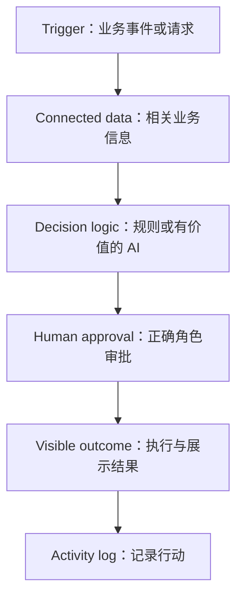

# HACKATHON_PROJECT_CONTEXT

> 项目交接基准：2026-10-20，Asia/Kuala_Lumpur（MYT，UTC+8）。
> 用途：让下一位 ChatGPT 延续 SDC Hackathon 项目讨论与开发，避免重新发明需求或将提案误当已完成产品。

## 阅读前须知：证据与状态

本文件依据当前对话、可检索的相关历史聊天、四份 PDF 的当前可提取文字，以及一张图片的可提取文字整理。**并未取得所有历史聊天的完整逐字记录，尤其未找回之前完整 MVP 提案正文。** 本文件尽可能恢复已经有证据的逻辑，但不是对缺失正文的猜测性重建。

| 标记 | 含义 |
| --- | --- |
| Confirmed — requirement | 主办方题目中的明确要求；不代表团队已经实现 |
| Confirmed — user | 用户明确表达的目标、约束或计划 |
| Proposed | 之前助手提出的方案，或用户仍在询问是否合适的方向；没有证据表明团队最终接受 |
| In Progress | 仅用于有实际进行证据的工作；不能依据计划日期推定 |
| Rejected / Future Scope | 仅在有明确否决／延期证据时使用 |
| Not specified | 当前可读取资料未给出；不等于过去绝对没讨论过 |
| Needs confirmation | 存在冲突、歧义，或需要确认提案是否已成为团队决定 |

来源编号：S1 = Domain 2 官方题目；S2–S4 = workshop PDF；S5 = image.png；C1 = Company Summary Request 历史聊天检索；C2 = Workshop Summary Alignment 聊天。完整目录见第 15 节。

## 1. Project Overview

| 项目 | 当前可确认内容 | 状态／来源 |
| --- | --- | --- |
| 项目名称 | StockTrace；用户也写作 stock trace | Proposed 名称；C1、C2 |
| Hackathon | SDC Hackathon，2026；Domain 2 | Confirmed；S1、C1 |
| Domain 名称 | Orbyte Smart SME Challenge: Less Busywork, Better Business | Confirmed — requirement；S1 |
| Domain sponsor | Alpha Red Solutions Sdn Bhd | Confirmed；S1 |
| 背景 | 为 Orbyte ecosystem 开发可供多家 micro and small businesses 采用的自动化产品 | Confirmed — requirement；S1 |
| 当前方案 | explainable inventory-discrepancy resolution，即可解释的库存差异处理 | Proposed；C1 |
| 核心差异点 | Evidence-Based Decision Replay | Proposed；C1 |
| 目标市场 | Malaysian micro and small businesses 的 owners and small teams | Confirmed — requirement；S1 |
| 更细行业／首个试点商户 | Not specified | 未找到确认记录 |
| 产品价值 | 当前提案通过证据、人工复核、审批及最终行动的可追溯性处理库存差异；题目要求减少重复工作，提高 accuracy and consistency，并保持 people in control | 提案与官方要求分别记录 |

一句话介绍（对现有提案的归纳，不代表已批准的宣传文案）：**StockTrace 是面向 Orbyte 生态的库存差异处理自动化提案，以 Evidence-Based Decision Replay 呈现处理依据、复核修改、审批者及最终行动，让 SME 在保留人工控制的情况下完成差异处理。**

用户是本次 AI automation 方向的初学者，希望学得懂、做得出，并在约 200 支队伍中形成差异化。200 支为用户表达的竞争背景，未由赛事文件独立核实。用户希望先确认 problem-solution alignment，再确定可在短期完成的 MVP，而不是只听到泛泛的鼓励或得分保证。（C1、C2）

## 2. Problem Statement

### 2.1 官方原文

> How might we design a reliable, easy-to-learn automation product for the Orbyte ecosystem that removes one recurring operational burden for micro and small businesses, improves accuracy and consistency, and keeps people in control, so it can serve many SMEs?

来源：S1，PDF 第 2 页。

### 2.2 官方描述的主要问题

- SME 依赖 manual follow-up、disconnected applications、spreadsheets、messages，信息与工作分散。
- 老板可能在晚上仍需追 supplier orders、customer enquiries、quotations 或 payments；遗漏可能导致 missed deadlines 和 stock shortages。
- 小企业难以负担 custom systems，以及复杂系统所需的培训时间与费用。
- 员工 digital confidence 不同，因此自动化需要可靠、一致、容易理解。
- 有用的自动化需要连接正确业务信息、遵守 roles and permissions、把重要行动交给人审批，并留下行动记录。

以上是题目背景，不是团队已完成访谈后取得的用户验证。（S1，第 3–4 页）

### 2.3 当前项目如何理解问题

当前提案将范围收窄至 **inventory discrepancy 的处理**，并以可解释、可追溯的纠正过程形成区别。（C1）库存差异的具体成因、频率、成本、涉及哪些文件和数量关系：Not specified。

用户曾问：赞助公司是 fintech，公司题目是否限制业务领域，storage management 是否走对方向。S1 明确允许 inventory、procurement、logistics 等多个领域，所以库存方向在题目允许范围内。但**领域允许不等于当前产品已证明 fit、创新性或能够高分**；仍需证明具体痛点、完整自动化、易学、人工控制、Orbyte fit 和可衡量价值。

“storage management”具体指仓储业务还是文件存储，原意 Needs confirmation。后续 StockTrace 提案是库存差异处理，不能将两者无条件视为相同。

## 3. Ideation Journey

| 阶段 | 有证据的讨论内容 | 状态与边界 |
| --- | --- | --- |
| 了解赞助公司 | 用户研究 Alpha Red Solutions，并给出 LinkedIn 链接 | C1；公司资料不是产品需求 |
| 初始业务方向 | 用户关注 storage management，询问 fintech 公司是否限制方向 | 尚在确认领域是否合题 |
| 要求更完整 MVP | 用户要求包含 ideation、语言、构建内容和 4–5 人任务分配的可靠且有创意计划 | 请求本身已确认；具体方案正文未恢复 |
| 对竞争力提出疑问 | 用户担心当前想法在约 200 队中不够突出，要求确认 alignment 与可实现性 | 未取得客观竞争评估 |
| 最近可找回的助手提案 | StockTrace：explainable inventory-discrepancy resolution；突出 Evidence-Based Decision Replay | Proposed；不是团队最终批准证据 |
| Workshop 后再核对 | 用户问模块是否是一条完整 flow，StockTrace 能否成为 Orbyte extension | 这是询问，不能写作已实现集成 |
| Workshop 总结范围调整 | 用户最后要求只总结 workshop 与题目的关系，暂不包含自己的 idea | 明确的是该次总结范围，不是放弃 StockTrace |

### 已讨论的优缺点与演变原因

- 用户认为原本想法可能不够突出，是要求增强 creativity 的原因。（C1）
- 用户强调时间短、初学者团队需要可靠 MVP，是要求控制可实现性的原因。（C1）
- 助手最近提案把可解释的证据与决策回放作为特色；是否优于曾讨论的其他方案、团队是否认可：Needs confirmation。
- 其他候选方案名称、逐项比较、被替换功能、否决原因：Not specified。不能将“普通聊天机器人”“完整 ERP”等自行写成团队曾提出且否决的选项。

**当前最终方案的准确说法：最近可找回的方案为 StockTrace 提案；团队最终定案记录未取得。** 用户计划在 10 月 20 日确认 ideation，不代表该确认已经发生。

## 4. Target Users and User Needs

| 维度 | 已知信息 |
| --- | --- |
| 官方画像 | Malaysian micro and small businesses 的 owners and small teams，日常依赖 WhatsApp、spreadsheets、paper 和 manual follow-up |
| 项目用户细分 | 对库存差异处理有需求的 SME 是当前提案对应方向；确切行业、岗位、商户规模 Not specified |
| 操作参与者 | 题目要求存在执行工作的人，以及有正确角色权限的审批者；角色名称和是否同一人 Not specified |
| 痛点 | 官方指出信息分散、重复追踪、遗漏、培训成本；StockTrace 对应的具体痛点描述尚缺完整正文 |
| 用户需求 | 减少一项重复负担，提高准确一致性、易学、有审批与记录；库存提案另强调解释依据与追溯 |
| 真实用户验证 | Not specified；没有可确认的访谈对象、测试结果或采用承诺 |

典型使用情境仅能确定到：SME 需要处理一项库存差异，相关证据被用于复核与最终授权。具体商品、门店、金额、盘点数字、单据样例 Not specified；本文件不编造示例数据。

## 5. Core Features

以下是业务能力清单，**不是已批准页面、工程模块或已实现功能清单**。除 Evidence-Based Decision Replay 外，中文描述用于组织资料，不是从历史提案恢复的正式功能名称。

| 功能／能力 | 解决问题与使用方式 | 输入 → 处理 → 输出 | 功能衔接 | 当前状态 |
| --- | --- | --- | --- | --- |
| 库存差异处理 | 用户处理库存 discrepancy；入口操作 Not specified | 差异相关业务输入 → 形成可解释的处理过程 → 处理结果；差异检测算法及纠正动作 Not specified | 当前产品的核心用例 | Proposed；C1 |
| Connected data | 把相关业务信息连接供决策使用；用户如何提供信息 Not specified | 相关业务资料 → 汇集业务上下文 → 可用于后续决策的信息；来源和格式 Not specified | Trigger 后、Decision logic 前 | Confirmed — requirement；S1；项目实现未确认 |
| Decision logic | 决定下一步行动；题目允许 rules 或 AI，仅在有价值处用 AI | Connected data → 决策 → 下一步行动依据；具体规则 Not specified | 为人工审批提供处理依据 | Confirmed — requirement；S1；实现未确认 |
| Human approval / 权限控制 | 正确角色在 consequential action 前审批 | 待审行动与相关信息 → 有权限的人审批 → 授权结果；按钮、拒绝流程 Not specified | 决策之后、后果性行动之前 | Confirmed — requirement；S1；实现未确认 |
| Visible outcome / activity log | 用户看到任务结果，并能追踪行动 | 审批后行动 → 执行和记录 → 可见结果与 activity/audit record | 闭合主流程 | Confirmed — requirement；S1；实现未确认 |
| Evidence-Based Decision Replay | 回看纠正所依据的证据、复核修改与最终授权；具体如何打开回放 Not specified | 证据、review changes、审批者、final action → 回放决策经过 → 可解释的处理记录 | 贯穿证据、复核、审批与结果；具体是否复用同一 audit 数据结构未确认 | Proposed；C1 |

### Evidence-Based Decision Replay 的边界

已恢复的意义是“解释证据如何支持 correction，并呈现 review changes 和 final authorisation”。不能自行把 Replay 扩充成视频回放、自动撤销、时间旅行、反事实模拟、区块链或不可篡改存证。其数据字段、视觉形式、保存机制：Not specified。

## 6. Complete User Flow

### 6.1 官方必须完成的端到端流程

这条流程已经确定为赛事要求，StockTrace 的具体操作方式仍待恢复／确认。

### 6.2 StockTrace 当前可恢复的主流程

以下按业务顺序整理“题目必需链路 + 已恢复的提案要点”，**不是声称已找回逐步界面设计**。

| 步骤 | 用户动作／系统行为 | 输入与输出 | 确认程度 |
| --- | --- | --- | --- |
| 1. 首次进入 | 用户接触系统，进入库存差异处理功能 | 首屏、登录、onboarding、企业选择 Not specified | 用户必须如何进入尚未定义；题目允许模拟 login/profile/RBAC |
| 2. 开始任务 | 一个业务事件或请求启动处理 | Trigger 类型、是否手动提交、自动事件或文件上传 Not specified | Trigger 是官方必需；项目入口未确认 |
| 3. 连接业务信息 | 系统汇集与任务相关的数据 | 输入文件、外部来源、数据格式、匹配字段 Not specified | Connected data 是官方必需 |
| 4. 形成处理依据 | 系统使用规则或有价值的 AI 决定下一步 | 具体 discrepancy 规则、建议内容、置信度 Not specified | Decision logic 是官方必需；StockTrace 的“可解释”方向为提案 |
| 5. 人工复核 | 现有提案提到 review changes，并保留纠正所依据的证据 | 可修改哪些内容、是否强制填写原因 Not specified | review changes 属已恢复的 Replay 提案内容；操作次序细节待确认 |
| 6. 授权 | 正确角色对 consequential action 作出审批 | 审批者与最终授权属于回放内容；角色名及审批机制 Not specified | 审批前置是官方必需；界面未确认 |
| 7. 执行并显示结果 | 审批后的行动完成，用户看到结果 | 是修改库存、生成待办或其他行动 Not specified；不能假定一定写回库存表 | Visible outcome 是官方必需 |
| 8. 追溯 | 查看 activity log；提案另可回看证据、复核修改、审批者和 final action | 记录／回放展示；具体入口与布局 Not specified | 日志为官方必需；Replay 为 Proposed |

### 6.3 功能间的关键关系

1. Connected data 提供业务上下文，Decision logic 基于该上下文决定下一步。
2. Human approval 位于 consequential action 之前，不能因加入 AI 而绕过。
3. Visible outcome 需要实际闭合任务，并记录行动；只有建议文字不足以证明整条链路。
4. Replay 提案用于解释处理依据和授权经过；它不能替代 Connected data、审批或实际结果。
5. 当前没有确认 Replay 是否单独页面，或是否作为任务详情的一部分。

### 6.4 替代流程、错误流程与特殊情况

| 情况 | 现有资料中的要求／缺口 |
| --- | --- |
| 缺资料或异常 | S1 的可选 explainable decisions 提到应清楚交给人处理；StockTrace 的检测与转交方式 Not specified |
| 审批拒绝／要求修改 | Not specified；不能声称已有退回与重新提交机制 |
| 无权限访问／操作 | 题目要求说明谁能看或操作；具体提示和权限矩阵 Not specified |
| 未发现差异 | Not specified |
| 数据不一致、解析失败 | Not specified |
| AI/API 不可用 | Not specified；题目要求说明最难风险与 plan/fallback，但团队 fallback 未找回 |
| 行动执行失败、重复执行、撤销 | Not specified |

## 7. System Logic and Workflow

### 7.1 已确定的系统约束

- 一条核心自动化 journey：Trigger → Connected data → Decision logic → Human approval → Visible outcome/activity log。
- rules 或 AI 均被允许；**AI only where it adds value**，没有“所有步骤都必须 AI”的要求。
- consequential action 必须由正确角色审批，说明 view/act 权限，并保留记录。
- login、user profiles 和 RBAC 可以模拟，不要求重做平台基础。
- 使用团队自建 synthetic data、interface、data structures 和 API assumptions。
- 无须 live Orbyte access，不能把实际平台接入当完成 MVP 的前提。

### 7.2 逻辑职责与信息传递

| 逻辑环节 | 职责 | 向下一环节传递什么 | 未定实现 |
| --- | --- | --- | --- |
| Trigger | 启动业务任务 | 业务事件或请求上下文 | 事件结构、任务 ID、触发方式 |
| Connected data | 连接相关信息 | 决策所需业务上下文 | 文档检索、API、上传与解析方式 |
| Decision logic | 形成下一步判断 | 行动依据／待审行动 | 规则、模型、提示词、阈值 |
| Human approval | 人保留控制权 | 授权结果 | 角色、状态机、复核字段 |
| Outcome / log | 执行、展示、记录 | 结果与行动记录 | 持久化、错误恢复、外部写回 |
| Replay（提案） | 解释证据与最终授权经过 | 人可理解的回放信息 | 是否读取同一事件流、排序、版本保存 |

这些是逻辑职责，不代表已经采用微服务、agent 架构或某种目录结构。

### 7.3 Workshop 与项目实现的区别

Workshop 标题是 **Agentic Development with Cloudflare cf CLI by Alpha Red**，以使用 RAG 的 sample chatbot 作演示。历史 workshop 总结提到 document retrieval、structured extraction、tool calls、saved progress、human approval。（S2–S4、C2）

它说明 AI automation 可将分散资料连接到业务动作。**Workshop 展示 RAG／Cloudflare／Qoder，不等于 StockTrace 已选择这些技术。** StockTrace 具体哪些步骤由 AI 完成、哪些由确定性规则完成，Not specified。

## 8. UI/UX and Design Decisions

题目要求 easy-to-learn、无需 costly formal training；允许团队创造能力和体验，无须复制 Orbyte 当前 screens。（S1）

| 项目 | 当前记录 |
| --- | --- |
| 已批准页面清单、页面名称 | Not specified |
| 每页用途与导航 | Not specified；第 6 节是业务流程，不是页面路由 |
| 关键交互 | 审批、可见结果、查看记录是业务要求；具体按钮、表单和弹窗 Not specified |
| Replay 视觉形式 | Not specified |
| 配色、字体、组件、布局、响应式 | Not specified |
| 被修改／否决的 UI | Not specified |
| Figma / FigJam | Not specified；未取得链接 |
| 已完成界面与待完成界面 | Not specified；不可把全部标为已开始 |

S2/S3 引用一个 ChatGPT Site simulation 链接（见第 15 节），但未直接读取其当前页面，也没有证据说明它是 StockTrace 原型。Workshop 附件的图片式 slides 没有完整可读内容，不能据此恢复 StockTrace 页面设计。

## 9. Technical Architecture

| 技术项 | 项目已确认选择 |
| --- | --- |
| 编程语言 | Not specified；用户曾要求规划语言，但完整回答未恢复 |
| 前端框架、UI library | Not specified |
| 后端框架／运行环境 | Not specified |
| 数据库、schema、持久化 | Not specified |
| AI 模型、供应商、API | Not specified |
| RAG / embeddings / vector database | Not specified；只有 workshop 的 RAG 示例证据 |
| Cloudflare cf CLI | Workshop 名称中的技术，不是已确认项目依赖 |
| Qoder | Workshop setup 链接，不是已确认团队 IDE |
| 外部服务／Orbyte integration | 目标是适配 Orbyte shared business hub；实际 connector/API Not specified |
| 部署平台、URL、环境变量 | Not specified |
| GitHub repository、branch、README | Repo 链接 Not specified；赛事要求提供可访问 repo |
| 输入数据结构、API contract | 题目要求团队自行定义；项目定义 Not specified |
| 已实现部分／代码文件 | Not specified；未取得代码供检查 |

### 架构边界

可确认的是业务链路与“Orbyte potential extension/product”定位。不能宣称已获得 Orbyte credentials、sandbox 或 production access。题目明确不提供 dataset、mock API、sandbox、production access、customer data 或 dedicated mentoring。（S1，第 7 页）

数据隐私要求是仅用团队创建的 synthetic data，并简述真实部署如何处理 privacy 和 Malaysia PDPA principles。这里记录的是比赛要求，未找到团队已确定的隐私实现方案。

## 10. Hackathon Requirements and Judging Criteria

### 10.1 主题、边界与交付

- Domain 2 difficulty：Intermediate。
- 产品形式可为 web/mobile application、intelligent agent、API service 或 working proof of concept。
- 聚焦一个明确、真实且重复发生的 SME operational burden；演示一个清楚用例。
- 新增 distinct SME business capability，不能复制 Orbyte existing HR and administrative functions。
- 适配 Orbyte 共享业务 hub，可供多家 SME 复用，而非单一机构内部系统。
- 使用 synthetic data；不得使用真实 personal/customer/company records。
- Out of scope：真实付款处理、statutory filings、legal or financial advice。可用合成数据示范准备性流程。
- 初赛无需 finished product，但需最重要功能的 rough working version；题目 rubric 同时强调核心 journey running live。准备时不能把“未完成全部产品”理解为无需闭合流程。
- GitHub repository link 必须提供，public 或 judges 可访问，并与 demo 一致。
- 具体 submission format 和 length limits 需遵守，但 S1 没给出确切字数／页数。

### 10.2 六项 Must-Have

| 必需项 | 期待内容 |
| --- | --- |
| One clear SME problem | 定义明确且有意义的具体问题 |
| Core automated journey | 业务输入到有用结果；AI 只用于有价值处 |
| Accuracy and ease of learning | 准确一致，容易理解，减少培训负担 |
| People stay in control | view/act 权限、行动前人工审批、简单审计记录；可以模拟 |
| Orbyte fit and reuse | 适配 connected hub，并能用于多家 SME |
| Business benefit and SDG | 提出可衡量业务价值及 SDG 贡献 |

### 10.3 初赛评分

| Criterion | Weight | 与本项目相关的要求 |
| --- | --- | --- |
| Innovation & Creativity | 30% | 具体 SME 痛点、原创自动化、市场吸引力；AI 有价值，不是换皮 chatbot／既有 HR admin 复制 |
| Problem-Solution Fit | 25% | 降低重复工作、准确一致、易学、权限审批记录、Orbyte fit、多 SME 复用 |
| Feasibility of Build | 25% | 核心链路 live、GitHub 支撑、synthetic data 与自身 API 假设、最难风险及 fallback、不依赖 live Orbyte |
| Clarity of Proposal | 20% | problem → approach → expected outcome；有可衡量收益，冷听者能理解，遵守格式长度 |

Band 百分比乘 criterion 权重形成对应分数。初赛成绩不带入决赛；决赛使用不同 rubric，届时发给 finalists。**当前没有决赛 rubric，不得沿用初赛比例声称是决赛标准。**

### 10.4 SDG 与可选项

主要对应 SDG 8 的 targets 8.2（技术升级与创新提升生产力）和 8.3（创业及 MSME 成长）。S1 允许在真正相关时补充 SDG 10 或 SDG 12。StockTrace 最终选择的 SDG 与论证：Not specified。

Optional 项目包括真实 SME 验证、automatic triggers、explainable decisions、reusable connector/module/API、business model、growth path。它们不是额外独立计分项目，不代表团队全部承诺开发。

### 10.5 团队计划与时间

以下来自用户计划，均为 2026 年、MYT；日期已到不代表工作已完成。

| 日期 | 用户明确提出的安排 | 状态 |
| --- | --- | --- |
| 10 月 20 日 | 确认 ideation | Planned；定案结果 Needs confirmation |
| 10 月 21 日 | Building | Planned |
| 10 月 22 日 16:00 | Meet mentor | Planned；反馈 Not specified |
| 10 月 23 日 | Final update | Planned；具体更新范围未定 |
| 10 月 24 日 | Documentation、制作 5–7 min video、准备 submission doc | Planned；视频时长由用户提供，S1 未独立载明 |
| 10 月 25 日 08:00 | Submission deadline | 用户提供；具体提交入口与官方截止公告未取得 |

用户也表达“just have 4 days left”，同时列出 19 日到 25 日的安排。**Needs confirmation：四天是有效开发天数还是其他计算方式。执行排期应保留明确日期，不擅自重算成团队已认可的天数。**

S1 说不提供 dedicated mentoring；用户计划 22 日 meet mentor，两者可能指不同支持渠道。**Needs confirmation：导师身份与会议来源。** 不应因此删除用户会议，也不能写成赞助方保证的辅导。

## 11. Current Progress

### Completed

- 已存在／已读取：S1 Domain 2 题目，三份 workshop PDF，image.png 的可提取文字。
- 已有相关项目讨论，以及助手提出的 StockTrace / Evidence-Based Decision Replay 方向。
- 已明确用户的目标、约 4–5 人规划需求和上述日期安排。
- 本交接文档已整理；它不证明产品开发已经完成。

### In Progress

- 项目开发、页面实现、数据集制作、原型制作：Not specified。没有足够证据将任一项标为 In Progress。

### Planned

- 10 月 20 日确认想法、21 日构建、22 日导师会议、23 日 final update、24 日文档与视频、25 日提交。
- 用户曾要求适合 4–5 人的完整任务分配，但成员姓名、实际人数、owner 分配和认领情况 Not specified。

### Blocked

- 交接资料存在缺口：完整 MVP 提案正文、最终团队确认、代码与原型链接未取得。这是资料缺口，不代表团队实际开发被阻塞。
- 团队实际 blockers：Not specified。

### Rejected

- 没有可核实的团队否决功能清单。
- 赛事不允许的行为见第 10 节；它们是规则边界，不是团队曾构建后否决的方案。

### Future Scope

- 题目允许 broader features 作为 future roadmap，但团队具体 roadmap Not specified。
- Orbyte extension 是讨论中的定位；不能写成“集成已完成”或擅自标为已同意的后续版本。

### 工件状态

| 工件类型 | 可确认状态 |
| --- | --- |
| 页面／功能／可运行 demo | Not specified |
| 代码／测试／部署 | Not specified |
| Figma／原型 | Not specified |
| 完整 MVP proposal | 曾有助手输出；本次未恢复全文 |
| 比赛与 workshop 资料 | 已取得，详见参考目录 |
| 5–7 分钟视频／最终 submission doc | 用户计划制作；完成状态 Not specified |

## 12. Important Decisions and Rationale

| 决定或方向 | 原因／解决的问题 | 后续影响 | 状态 |
| --- | --- | --- | --- |
| 遵循 Domain 2 五段 journey | 题目明确要求完整自动化，并保持人工控制 | Demo 必须覆盖输入、决策、审批、结果与记录 | Confirmed — requirement |
| 当前提案收敛至 StockTrace 库存差异处理 | 用户要求更具体、可行、具创意的 MVP；完整择优论证缺失 | 继续讨论时以该提案为最近基线，先核实是否已获团队接受 | Proposed |
| 突出 Evidence-Based Decision Replay | 最近提案的核心创新表达；用户关心 stand out | 后续需保留术语及证据—复核—授权—结果关系 | Proposed |
| 对 consequential action 保留人工审批 | 官方要求 people stay in control | AI 建议不能直接等同已授权行动 | Confirmed — requirement |
| 可模拟 platform foundations，不依赖 live Orbyte | 官方无需平台 access，且不提供 sandbox/API | 团队可自行定义合成接口；不等于已选定实现 | 规则允许，实际方案未确认 |
| 优先完成一个核心用例 | 题目 focus 要求，与用户短期排期一致 | 不能把可选功能全部当 MVP scope | Confirmed — requirement |
| 10 月 20 日先定 ideation | 用户需尽快开始构建，并在 22 日见导师 | 定案确认是接手后的关键资料缺口 | Confirmed — user plan |
| Workshop 总结先不放个人 idea | 用户要求分享用 summary 聚焦 workshop alignment | 只约束该次总结，不改变产品方向 | Confirmed — user |

目前**没有充分证据可列为“团队已经批准、不可改动的技术选型”**。不可擅自改变的是题目硬约束与用户既定时间安排；产品提案仍应核实状态。

## 13. Open Questions and Risks

### 13.1 需要确认的核心问题

1. StockTrace 是否已在 10 月 20 日被团队最终确认？正式拼写与一句话定位是什么？
2. 原 full MVP proposal 的正文在哪里？是否后来被修改？
3. “storage management”原意与当前 inventory-discrepancy resolution 的关系是什么？
4. 首个具体 SME 行业、岗位、库存差异场景及频率是什么？
5. Trigger、输入文件／字段、关联方式、检测条件、最终行动是什么？
6. Evidence-Based Decision Replay 具体展示哪些信息，如何打开与保存？
7. 复核者与 approver 的权限，以及拒绝、退回、缺资料流程是什么？
8. 技术栈、模型、API、数据结构、托管平台最终选择是什么？
9. 4–5 人的实际成员与认领分工是什么？
10. GitHub、Figma、原型和部署链接在哪里？目前实际完成了什么？
11. 22 日导师会议由谁提供？是否有过其他导师反馈？
12. 截止日期、视频 5–7 分钟、提交格式是否另有官方公告可核对？

### 13.2 风险登记

本表是根据现有资料辨识的交接风险，不是声称团队已讨论并接受对应解决方案。

| 风险 | 已知依据 | 当前未定项 |
| --- | --- | --- |
| Alignment 仅停留业务领域 | inventory 被允许，但还要证明一个 recurring burden | 具体场景、闭环及效益 |
| 创意难以证明 | 用户明确担心 200 队竞争；Replay 是提案特色 | 可运行机制与真实价值证据 |
| 时间与实现 | 用户给出紧凑日期、初学者背景 | scope、技术选型、分工、实际进度 |
| AI 准确性与必要性 | 题目强调 accuracy 和 AI only where valuable | AI 任务、验证、fallback |
| UX 学习成本 | 目标用户 digital confidence 不一 | 页面、术语、可用性验证 |
| 数据连接和执行边界 | 不提供平台 API/sandbox | 合成输入、接口假设、结果如何完成 |
| 审批和追溯只做成说明文字 | 题目要求可见流程和记录 | 实际权限／审批／日志实现 |
| 效益被误写成已验证 | 题目要求 measurable benefit | baseline、目标、测量过程；不得编造节省比例 |
| 上下文失真 | 历史 MVP 全文未恢复 | 需保持 Proposed 与 Confirmed 分离 |

## 14. Next Steps

### 14.1 用户已明确的计划（按先后顺序）

1. **10 月 20 日：确认 ideation。** 需要核实这个节点是否已经完成，而非重新宣布未完成。
2. **10 月 21 日：Building。** 用户希望据完整 MVP 开始构建；具体任务 owner 未取得。
3. **10 月 22 日 16:00：见 mentor。** 反馈到达前，不写入任何导师意见。
4. **10 月 23 日：Final update。** 根据实际项目进度调整；原记录未列具体修改项。
5. **10 月 24 日：完成 documentation、5–7 分钟 video、submission doc 准备。**
6. **10 月 25 日 08:00 前：提交。** 提交入口和官方格式需核对。

### 14.2 Suggested next steps — not yet agreed by the team

以下仅是本次交接整理提出的补缺建议，**不是历史团队决定**：

1. 优先找回完整 MVP proposal 和 10 月 20 日后的定案／进度，确认 StockTrace 与 Replay 的实际 scope。
2. 用一个已选定的合成库存差异案例，填齐第 6 节输入、判断、审批和最终行动的空白。
3. 根据现有代码核实技术栈、可运行链路、角色分工；不要仅按提案推断。
4. 以 S1 六项 must-have 和初赛 rubric 核对 demo，明确最难风险与 fallback。
5. 补齐 GitHub、页面／原型、指标测量及官方 submission 要求，再同步本文件。

## 15. Glossary and Reference Materials

### 15.1 术语表

| 术语 | 本项目语境 |
| --- | --- |
| StockTrace / stock trace | 当前最近提案的项目名；正式命名待确认 |
| inventory-discrepancy resolution | 库存差异处理；最近提案的范围 |
| Evidence-Based Decision Replay | 以证据解释 correction，并呈现 review changes、审批者、final action / final authorisation 的提案特色 |
| Orbyte | 题目中的 shared business hub；拟适配其生态，不代表已连入平台 |
| SME / MSME | 小型／中小微企业语境；本题重点 micro and small businesses |
| Trigger | 启动任务的业务事件或请求 |
| Connected data | 为任务汇集相关业务信息 |
| Decision logic | 使用 rules 或有价值的 AI 决定下一步 |
| Human approval | 正确角色在 consequential action 前审批 |
| Visible outcome | 行动完成且用户能看到结果 |
| Activity log / audit record | 行动追踪记录；官方必需 |
| RBAC | Role-based access control；可模拟 |
| RAG | Workshop sample chatbot 使用的检索增强生成技术；项目是否采用未定 |
| MVP | Minimum Viable Product；本题需有可运行核心，不要求 finished product |
| PDPA | 题目要求简述真实部署的马来西亚数据隐私原则处理；团队方案未定 |

### 15.2 文件与读取情况

| 来源 | 名称／标识 | 用途与读取限制 |
| --- | --- | --- |
| S1 | SDC Hackathon Domain 2.pdf；libfile_38247e6e8fc0819185270abf9b47c56c | 9 页；已读取全部可提取文字；题目、must-have、边界、支持条件与初赛 rubric 的权威来源 |
| S2 | SDC Hackathon Summary Workshop(1).pdf；libfile_f97d53f2bd748191946299f8704927e4 | 16 页；已读可提取全文，并请求第 2–8 页图像读取；图像返回资源指针，未形成可完整核对的视觉内容，不能声称已读全部 slide 图片 |
| S3 | SDC Hackathon Summary Workshop.pdf；libfile_99da27ac1b608191a9479839f20daa29 | 16 页；已读可提取全文；与 S2 提取文本一致，但没有逐字节验证相同；不能把副本名当新版本决策证据 |
| S4 | SDC Hackathon 2026.pdf；libfile_3bd67d91f1d48191b3cfb3710abc92cd | 12 页；可提取内容是 workshop 邀请、RAG Flow、What is Orbyte；不能因文件名视作完整赛事规则 |
| S5 | image.png；libfile_5df16d8b9908819180619a4a46a26178 | 618×683；已请求图片读取，取得文字与图片资源指针，未完整视觉核验。内容涉及 Orbyte walkthrough、standalone prototype／integration 与 credentials 的提问；回答归属及完整答复不清，不能当已获平台权限 |
| C1 | Company Summary Request，2026-10-19 至 20 日相关聊天 | 用户关切、日期与 MVP 请求，以及检索恢复的 StockTrace / Replay 提案摘要。未取得完整助手 MVP 正文或对话永久链接 |
| C2 | Workshop Summary Alignment，2026-10-20 | 用户问模块 flow、StockTrace extension、alignment；最后要求只总结 workshop，不加入自己想法。未取得完整逐字聊天 |

### 15.3 已出现的链接

这些链接仅记录来源中的引用，**本次未访问其当前网页，未核实内容、可用性或所有权**。不需要把这些参考网址当作接手前必须登录的服务。

- Alpha Red LinkedIn（用户此前提供）：https://www.linkedin.com/company/alpha-red-solutions/?originalSubdomain=my
- Orbyte 登录入口（S2/S3）：https://orbyte-xyz.alphareds.com/login
- Qoder workshop setup：https://qoder.com/en
- S2/S3 所列 simulation Site：https://hackathon-teammate-clef.cocoaspoon18.chatgpt.site/?view=agent&mode=simulation
  - 文件在其附近写有 “Orbyte website”；具体归属、是否为参考演示还是用户工件 Needs confirmation。不能认定为 StockTrace 部署。
- Workshop Zoom（S2–S4）：https://us06web.zoom.us/j/83159479408?pwd=Pvb9s0jvF8tfOkrTUBiUlLmeXJoZt1.1
  - Workshop 时间：2026-10-20，10:00–11:00 MYT；标题 Agentic Development with Cloudflare cf CLI by Alpha Red。
- 赛事联系：Instagram @sdc_xmumhack；email sdc.xmumhack@gmail.com；S1 建议经 Discord 联系，但具体 Discord 邀请链接 Not specified。
- GitHub、Figma/FigJam、StockTrace demo、Google Docs 最终 proposal 链接：Not specified。

Library ID 用于在支持对应文件访问的环境中定位原资料，不是公开下载链接。接手 ChatGPT 若无法访问附件，应请求对应内容，不能声称已查看。

## 16. Handover Instructions for the Next ChatGPT

### 项目的核心目标与当前方案

你正在协助一个时间紧、希望真正学会并做出可运行成果的初学者团队，参加 SDC Hackathon Domain 2。目标是为 Orbyte 生态解决一个 SME 重复性运营负担，兼顾准确、一致、易学、人工控制及多 SME 复用。

最近可恢复的提案是 **StockTrace：explainable inventory-discrepancy resolution**；特色叫 **Evidence-Based Decision Replay**。它需要解释纠正所依据的证据、review changes、审批者与 final action。团队最终是否确认该版本仍需核实。不能把“final full MVP”请求或助手称其为 final 的提案，当作团队签字定案。

### 最重要的 flow

**Trigger → Connected data → Decision logic → Human approval → Visible outcome + activity log。** 库存用例的具体输入、规则和执行动作尚缺；Replay 是解释处理过程的提案特色，不能代替真实闭环。先读第 6–7 节再协助设计或编码。

### 不可随意改变的约束

- consequential action 前保留正确角色的人审；权限和 audit record 必须说明。
- AI only where it adds value；不要强推聊天机器人或把 workshop 示例技术当选型。
- 仅用 synthetic data；不依赖 live Orbyte，不要求团队等待未提供的 API/sandbox。
- 不复制 Orbyte existing HR/admin；不做真实付款、法定提交、法律或金融建议。
- 专注单一核心用例；不把可选扩展塞成已承诺 scope。
- 维护第 10 节用户排期；状态未确认时不要假定任务已按期完成。
- 保留 StockTrace、Evidence-Based Decision Replay、Orbyte 和原流程术语。

### 接手后最值得做的工作

先核实最新定案与实际代码／原型，再恢复或补齐完整 MVP proposal。用确切业务数据和行动定义连起主流程，按真实成员确定开发任务，并协助准备导师会议、demo、文档和 5–7 分钟视频。第 14.2 节的补缺路径是建议，不是既定团队计划。

回答应清楚、具体、初学者可跟进。用户尤其关心是否 align、是否有区别、是否来得及。可以依据 rubric 解释匹配程度与证据缺口，不能保证高分或一定胜过其他队。

### 文档一致性检查与仍无法确认的信息

本次检查将官方要求、用户计划、助手提案和实际实现分开；没有把 workshop 工具写成项目技术栈，没有把参考 Site 当 StockTrace 原型，没有把待见导师写成已收到反馈，也没有将未取得的提案正文补写为事实。

截至本文件基准，以下仍无法从已取得资料确认：

1. 完整历史 MVP 正文、所有迭代和团队最终批准版本。
2. 项目正式名称、首个用户细分与真实验证结果。
3. 具体库存情境、输入文档／字段、判断规则、纠正动作与收益数字。
4. AI 任务、模型、框架、数据库、API contract 与部署架构。
5. Replay 的 UI、数据结构、记录机制与实现状态。
6. 页面清单、导航、配色、原型及其完成程度。
7. 真实团队成员、人数、分工与当前开发 blockers。
8. GitHub／代码／测试／demo／Figma／Google Docs 链接和实际产品进度。
9. 导师身份与反馈、dedicated mentoring 与会议安排的关系。
10. 官方提交入口、完整格式长度限制、视频时长与截止时间的独立公告。
11. “4 days left”的计算含义，以及 storage management 的原始含义。
12. Workshop PDF 图片式内容及 image.png 的完整视觉细节；引用网页当前内容与 simulation Site 归属。

**更新原则：新增证据后明确更新相关状态和来源；没有证据时继续保留 Not specified / Needs confirmation，不用看似合理的设计填补历史。**
